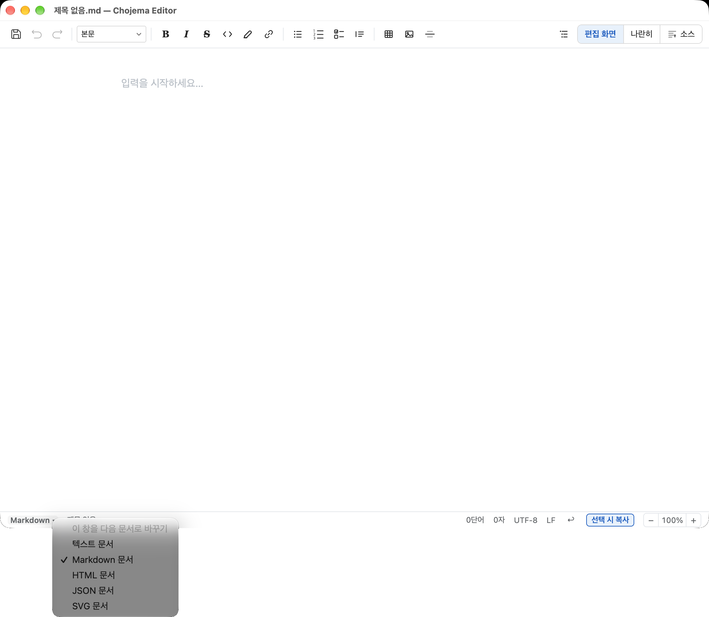

# Chojema Editor

[한국어](README.md) | **English**

An editor for plain text, Markdown, HTML, JSON and SVG, available as a Windows and macOS app and as a [web version](#web-version). Markdown and HTML are edited WYSIWYG (what you see is what you get).

## Installation

Download the file for your system from [Releases](https://github.com/chojema/chojema-editor/releases).

| System | File |
|---|---|
| macOS (Apple Silicon, M1 and later) | `Chojema.Editor-<version>-arm64.dmg` |
| Windows (regular PCs, Intel/AMD) | `Chojema.Editor-Setup-<version>-x64.exe` |
| Windows (ARM, e.g. Snapdragon laptops) | `Chojema.Editor-Setup-<version>-arm64.exe` |
| Windows (not sure which) | `Chojema.Editor-Setup-<version>.exe` — picks the right one during setup |

- **macOS**: open the DMG and drag the app into the Applications folder. If macOS blocks the first launch, Control-click the app in Finder and choose "Open", or click "Open Anyway" in System Settings → Privacy & Security.
- **Windows**: the setup wizard lets you choose the install folder and needs no administrator rights. If "Windows protected your PC" appears, click "More info" → "Run anyway".
- After installation, `.md`, `.markdown`, `.html`, `.htm`, `.txt`, `.json` and `.svg` files can be opened with the app.

## Web version

Use it in the browser without installing: **https://chojema.github.io/chojema-editor/**

Editing works as in the desktop app. Files are handled inside the browser and never sent to a server. There is no menu bar: click the document-type button at the left of the status bar (`Markdown ▾` and so on) for New, Open, Save, Export and Language. Keyboard shortcuts are the same as in the desktop app.

### Limits of the web version

The web version can only do what the browser allows, so some things differ from the desktop app.

| | Desktop app | Web version |
|---|---|---|
| Saving | Saves to the original file | Chrome/Edge: pick a location on the first save, later saves go to the same file. Firefox/Safari: every save downloads the file |
| Opening | Open dialog, drag and drop, double-clicking a file | Open dialog and drag and drop only. A dropped file asks for a location on its first save |
| Pasted images | Saved as files in an `assets/` folder beside the document | Embedded in the document (data URI), which makes the file larger |
| Files beside the document | Relative images and external CSS of HTML files are shown | Cannot be read, so they are not shown (web addresses still work) |
| PDF export | Writes a PDF file directly | Opens the print dialog; choose "Save as PDF". Margins and headers follow the browser settings |
| Several documents | One window per document | One tab per document |
| Shortcuts | All available | Shortcuts the browser keeps for itself, such as `Ctrl+N` and `Ctrl+W`, are not available |
| Theme | Light or dark can be chosen | Follows the system or browser setting |
| Closing | Asks whether to save | Only the browser's "Leave site?" warning |

## Features

| Document | Editing |
|---|---|
| `.txt` and others | Text editing (line numbers, find & replace, line wrapping) |
| `.md` | WYSIWYG editing. Tables, task lists, math (LaTeX), Mermaid diagrams, footnotes, code syntax colors, `/` command menu, frontmatter editing |
| `.html` | WYSIWYG editing. Font, size, color, alignment, sub/superscript, tables, images, links, code syntax colors |
| `.json` | Tree editing: line numbers, edit keys and values, add, delete and move items, change value types, find, format, minify, sort keys, syntax error locations |
| `.svg` | SVG source editing with a live image preview. Split view by default, syntax colors and error messages |

### SVG editing

Choose **Export as Image…** in the toolbar or File → Export to save PNG, JPG or WebP. PNG and WebP support transparent backgrounds; JPG uses the selected background color. Choose 1–4× scale and JPG/WebP quality (1–100). Backgrounds drawn inside the SVG are preserved. The web version downloads the image file.

Open a `.svg` file or choose File → New SVG Document to see source and image side by side. Source edits update the preview after a short pause. Preview-only and source-only views, adjustable pane widths, find & replace and undo are supported; saving preserves the SVG source. Invalid XML shows an error and renders again once corrected. The preview uses an image document, so scripts and external images/stylesheets are not loaded or executed.

### Views (Markdown and HTML)

Switch with the buttons at the right of the toolbar or the shortcuts.

| View | Shortcut | What you get |
|---|---|---|
| Visual | `⌘1` | WYSIWYG editing only |
| Side by side | `⌘2` | Source on the left, visual on the right. **Both are editable** and each follows the other after a short pause. Scrolling is linked; drag the divider to resize |
| Source | `⌘3` | Source code only |

For Markdown, a visual edit in the side-by-side view rewrites only the edited block in the source; every other line stays as written.

The source pane colours tags, attributes, values and comments (with separate light and dark colours) and offers completions while you type HTML tags and attributes. Typing an opening tag such as `
` adds the closing tag. Turn completions on or off in Edit → Source Autocomplete.

### Changing the document type

The app opens with an empty Markdown document. Click the document type at the left of the status bar (**Markdown ▾**), or choose New Text Document (`⌘N`), New Markdown Document (`⇧⌘N`) New HTML Document (`⌥⌘N`) or New JSON Document (`⌥⌘J`) in the File menu. A window you have not typed in yet switches in place; a window with content or a saved file opens a new window instead.

### More

- **Outline** (`⇧⌘O`): list of headings; click one to jump there
- **Find & replace** (`⌘F`, `⌥⌘F`): match case, replace, replace all
- **Export to PDF** (File menu, `⇧⌘E`) and **Print** (File menu, `⌘P`)
- **Export** (File → Export): Markdown → **Save as HTML…**, HTML → **Save as Markdown…**, or copy formatted text for mail and blogs. Exports the current visual, split or source view contents while keeping the original document open and unchanged.
  - HTML → Markdown converts headings, emphasis, quotes, lists/tasks, code, links/images and tables. Merged or nested tables remain HTML inside Markdown. CSS, fonts, page layout, scripts and interactive elements are omitted.
  - Markdown export adjusts link and image paths relative to the output folder. Image files are referenced, not copied; include them when sharing the export. Relative paths in untitled HTML documents are kept as written.
- **Legacy Korean files**: EUC-KR (CP949) and UTF-16 files open correctly; the status bar shows the encoding and line endings (LF/CRLF). Files are saved as UTF-8, with a confirmation the first time
- **Drag and drop**: drop a `.md`, `.html`, `.txt` or `.json` file on the window to open it
- **Text size**: the **− 100% +** buttons at the right of the status bar (`⌘−` / `⌘=`, `⌘0` for actual size). Applies to text documents, the visual editor and the source pane
- **Copy on select**: turn it on with the **Copy on select** button in the status bar or Edit → Copy on Select. Selected text then goes to the clipboard right away and a short "✓ Copied" tag appears; the visual editor copies formatting too
- **Language** (View → Language: Follow System / 한국어 / English). Applies immediately to all windows while preserving your edits.
- **Korean word wrapping** (HTML): the wrap button next to the alignment buttons turns it on for the whole document, the selected paragraphs or the selected table cells. It adds `word-break: keep-all` so Korean words are not split between syllables at line breaks. The whole-document setting goes on the `<body>` tag and is not undone by `⌘Z`; toggle it off instead. A word longer than its box is not broken and may overflow
- **Links** (`⌘K`; HTML documents can choose "Open in new window"), **themes** (View → Theme: system / light / dark)

### How the original text is preserved

- **Markdown**: blocks you did not edit are saved exactly as they were on disk. Opening a file and saving it unchanged produces a byte-identical file. Frontmatter, line endings (CRLF) and the BOM are kept.
- **JSON**: only what you change is written. Number spellings (`1.0`, large integers), string escapes, key order, indentation and line endings stay as they are. While the text has a syntax error the tree is read-only and you fix it in the source. JSON with comments (JSONC) is reported as an error.
- **HTML**: only the inside of `<body>` is edited; `<head>` and the `<body>` tag stay exactly as written. The document's own CSS is applied to the editing canvas, so you edit the page as a browser shows it. class, id, style and data-* attributes and layout elements such as `
`/`<section>` are kept. Elements that cannot be edited visually, such as `<script>`, `<iframe>`, `<form>` and SVG, keep their original code; double-click one to edit its code.

### Limits of HTML editing

- HTML comments (`<!-- -->`) are lost on save.
- After an edit, the saved body is laid out one block per line, and some CSS values may be rewritten (e.g. `#d33` → `rgb(221, 51, 51)`). A file you did not edit is saved exactly as it was.
- Table columns cannot be resized with the mouse.

## Changelog

Changes in each version are listed in [CHANGELOG.md](CHANGELOG.md) (in Korean).

## License

[Apache License 2.0](LICENSE). See [NOTICE](NOTICE) for notices.
